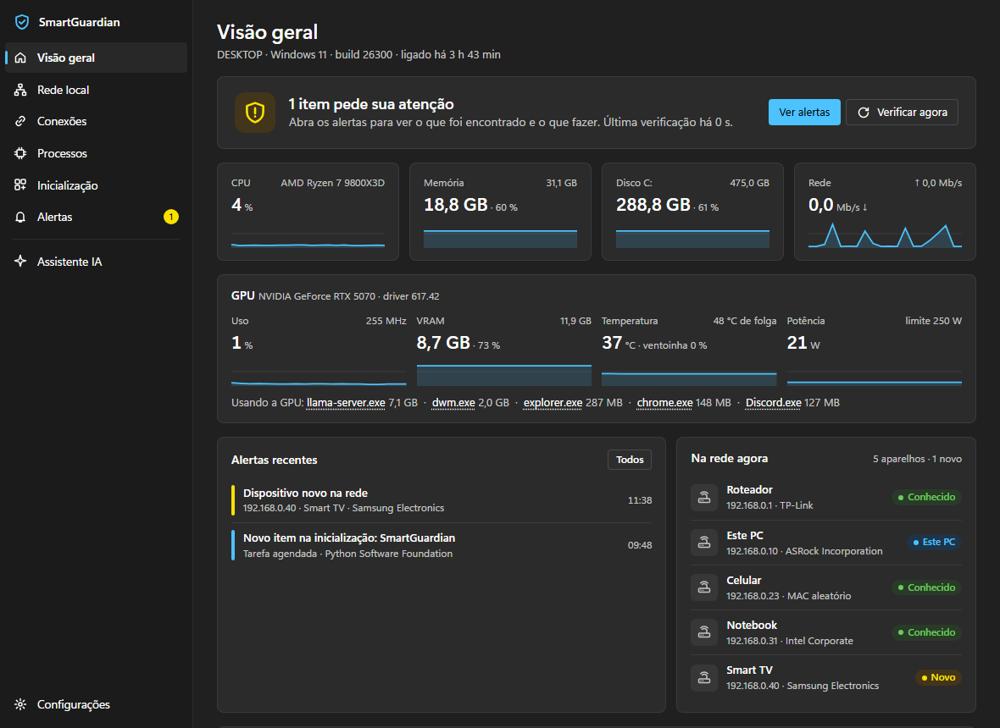

# SmartGuardian

Guardião do PC para Windows 11. Monitora processos, conexões, a rede local, a GPU e tudo que abre
com o Windows; dá a cada processo uma **pontuação de risco explicada** (você vê o motivo de cada ponto)
e avisa quando algo foge do normal. Tem um assistente opcional que roda **no seu PC** pelo
[LM Studio](https://lmstudio.ai): nada vai para a nuvem.

Fica como um ícone de escudo na bandeja, com janela no estilo do Windows 11. Mesma base do
[SmartDevices](https://github.com/dockst3r/SmartDevices).



<sub>Print do app real; nomes de aparelhos, IPs e o nome do PC trocados por exemplos.</sub>

## O que ele faz

| Tela | O que mostra |
|---|---|
| Visão geral | situação geral, CPU, memória, disco e rede da placa física (últimos 2 min); GPU com uso, VRAM, temperatura e folga até o limite térmico, potência, driver e quem está usando a placa; alertas recentes, aparelhos na rede |
| Rede local | conexão, roteador, DNS, latência da internet; aparelhos da rede com IP, MAC, fabricante e quando apareceram; clique no nome para renomear |
| Conexões | cada conexão de cada programa, com nome DNS; portas abertas neste PC e **se o firewall deixa alguém alcançá-las**; exportar CSV |
| Processos | assinatura digital, quem abriu, linha de comando, rede, uso de GPU e VRAM e **por que a pontuação**; Analisar com IA, Abrir local, VirusTotal, Encerrar, Quarentena, Isso é normal |
| Inicialização | chaves Run, pasta Inicializar, serviços automáticos e tarefas agendadas; ligar e desligar sem apagar nada |
| Alertas | histórico por dia; Ciente, Isso é normal, Pausar 1 hora, Resumir com IA |
| Otimização | mede o que dá para limpar (temporários, cache da Otimização de Entrega, despejos de travamento, relatórios de erro, shaders, Lixeira, limpeza do Windows Update pelo DISM) e mostra sugestões a partir dos sensores; limpa só o que você marcar, com prévia e confirmação |
| Assistente IA | conversa que consulta cada sensor conforme a pergunta (o funil), com respostas técnicas e detalhadas; conversas salvas, com o modelo, o tempo e o que foi consultado; relatório do dia em HTML |
| Configurações | intervalos, período de aprendizado, limite de aviso, tipos de aviso, modelo da IA (lista lida do LM Studio), VirusTotal, lista de confiança e quantos alarmes falsos cada regra já deu |

O ícone muda de estado: escudo normal = tudo certo, ponto amarelo = atenção, ponto vermelho = risco
alto, apagado = avisos pausados. Notificações do Windows avisam de processo suspeito, aparelho novo
na rede, mudança na inicialização, detecções do Windows Defender e GPU perto do limite de temperatura.

## Requisitos

- Windows 11 (funciona no 10, mas o visual é pensado para o 11)
- Python 3.12 ([python.org](https://www.python.org/downloads/))
- Permissão de administrador (o app pede ao abrir)
- Opcional: placa NVIDIA para o card completo da GPU (o uso por programa funciona com qualquer placa);
  LM Studio para o assistente; chave gratuita do VirusTotal

## Instalar e usar

```
git clone https://github.com/dockst3r/SmartGuardian.git
```

Depois, **dois cliques em `Instalar.bat`**. Ele cria o ambiente do Python (`.venv`), instala as
bibliotecas, cria o atalho **SmartGuardian no menu Iniciar** e abre o app (o Windows pede permissão de
administrador). Para atualizar: `git pull` e `Instalar.bat` de novo, que instala as bibliotecas novas.

- Abra pelo **menu Iniciar** (ou pela busca do Windows) como qualquer app. Com o app já na bandeja,
  o atalho só traz a janela para a frente, sem pedir permissão de novo.
- Fechar ou minimizar a janela só esconde; o monitoramento continua. Para encerrar: botão direito no
  escudo → **Sair**.
- **Configurações → Iniciar com o Windows** cria uma tarefa agendada que abre o app como
  administrador sem pedir permissão a cada login. **Atalho no menu Iniciar** liga e desliga o atalho.
- **`SmartGuardian (terminal).bat`** lista no terminal os processos sem assinatura confiável
  (`sg.py processos --todos` para todos).

### Proteja a pasta do programa

O SmartGuardian roda como administrador e pode iniciar sozinho no login. Se a pasta onde ele está
puder ser alterada por usuários comuns (é o caso de uma pasta criada direto em `C:\`), qualquer
programa sem administrador ganharia administrador só editando um arquivo dele. O app detecta isso e
mostra um aviso; em **Configurações → Proteger a pasta**, só administradores passam a alterar os
arquivos. Depois disso, para atualizar, use o `Instalar.bat` (ele pede administrador) ou um terminal
como administrador para o `git pull`.

A proteção grava as permissões só na pasta raiz; o resto herda. O perfil do WebView2 (o motor da
janela) fica fora dela, em `%LOCALAPPDATA%\SmartGuardian\webview`, porque parte dos processos do
WebView2 roda sem administrador e precisa gravar ali (dentro da pasta protegida a janela abria preta).
Ao abrir, o app encerra os processos do WebView2 que tenham sobrado de uma execução que caiu, e que
travariam esse perfil.

Se uma versão antiga do app deixou os arquivos sem nenhuma permissão (nem administrador abre), rode
num terminal como administrador:

```
icacls "C:\SmartGuardian\*" /reset /T /C
```

Por que não um `.exe`? Para um programa de segurança que roda como administrador, poder ler o código
antes de rodar é uma vantagem; um `.exe` sem assinatura digital pedindo administrador é justamente o
que o próprio app ensina a desconfiar, e empacotadores como o PyInstaller costumam gerar alarme falso
em antivírus.

Por que administrador: sem isso o Windows esconde o caminho de boa parte dos processos e não deixa
encerrar processos nem mexer na inicialização.

## Pontuação de risco

Cada processo começa em 0 e cada sinal soma pontos. Aviso a partir de 30 (ajustável), risco alto a
partir de 60. Pesos e listas ficam em `rules.json`, criado na primeira execução.

| Sinal | Pontos |
|---|---|
| Nome de processo do Windows fora da pasta do Windows (**forte**) | 40 |
| Conexão aberta pelo programa para uma porta usada por invasão (4444, 1337, 31337…), ou porta dessas aberta nele, TCP ou UDP (**forte**) | 30 |
| Pasta temporária ou gravável por qualquer usuário · assinatura quebrada · comando codificado · Office abrindo terminal · GPU acima de 50 % por ~15 s sem assinatura válida (perfil de minerador) | 25 |
| Sem assinatura digital | 20 |
| Pasta do usuário (AppData, ProgramData) · Downloads | 15 |
| Processo pai errado · sem assinatura e na internet · porta aberta para a rede (só se o firewall liberar) | 10 |
| Programa novo depois do aprendizado · sem assinatura em pasta protegida | 5 |

### Contra falso positivo

- **Nenhum sinal comum avisa sozinho.** O máximo é 25 (mesmo editando o `rules.json`) e o aviso
  começa em 30. Só as duas regras fortes avisam sozinhas, porque quase não acontecem com programa legítimo.
- **Assinatura válida anula as regras de local.** Discord em AppData e Defender em ProgramData ficam em 0.
  Não vale para nome do Windows fora do lugar: uma cópia do `svchost.exe` continua com assinatura
  válida da Microsoft.
- **Sem assinatura em Program Files ou Windows pesa só 5** (ferramentas do Git, por exemplo).
- **Período de aprendizado de 7 dias.** O que roda nesse período vira o normal. Se algo depois piorar
  (por exemplo, passar a usar uma porta de invasão), o aviso sobe de nível do mesmo jeito.
- **Isso é normal.** Programa assinado ganha confiança pela editora (continua confiável ao atualizar);
  sem assinatura, pelo hash (perde a confiança se o arquivo mudar). Cada clique conta como alarme falso
  da regra, e as Configurações mostram quais regras erram mais.
- **Inicialização:** só avisa de itens novos depois da primeira lista. Itens da Microsoft só ficam
  registrados, exceto quando chamam powershell, cmd, mshta e similares.

### Assinatura digital

Conferida como o Windows confere, sem internet (WinVerifyTrust): assinatura no próprio arquivo,
catálogo do Windows (System32) ou pacote da Microsoft Store/MSIX. Certificado vencido sem carimbo de
tempo conta como assinado, com observação.

## GPU

Placas NVIDIA: uso, VRAM, temperatura, folga até a placa reduzir o desempenho, potência, ventoinha,
clock e versão do driver, pela biblioteca oficial da NVIDIA (`nvidia-ml-py`, que usa o `nvml.dll` do
driver). Uso de GPU e VRAM **por programa** vem dos contadores do próprio Windows, e vale para
qualquer fabricante. Avisos opcionais: GPU perto do limite térmico e VRAM cheia por 30 s.
Minerador escondido aparece como uso alto e contínuo de GPU por um programa estranho, por isso a
regra do minerador (jogos, navegadores e o LM Studio são assinados e não disparam).
Hotspot e temperatura da memória não existem na API oficial para placas GeForce.

## Ações com proteção

- **Encerrar** fecha só o processo escolhido (não os que ele abriu) e confere que é o mesmo processo
  da tela, para não atingir outro programa que tenha reaproveitado o PID. Recusa processos essenciais
  do Windows (csrss, wininit, lsass, svchost do sistema…) e o próprio SmartGuardian.
- **Quarentena** encerra o processo e move o arquivo para `quarentena/`, com um `.json` dizendo de
  onde veio. Recusa arquivos do Windows, arquivos assinados pela Microsoft, programas assinados
  instalados em Program Files (para esses, desinstale ou use o Defender) e o Python que roda o app.
- **Desligar da inicialização** pede confirmação e nunca apaga: a entrada original fica guardada e
  volta igual ao religar. Serviços e tarefas do próprio Windows não são desligados por aqui (poderiam
  deixar o PC sem rede ou firewall), exceto os que chamam powershell, cmd, mshta e similares.

## Assistente de IA (LM Studio)

1. Instale o [LM Studio](https://lmstudio.ai) e baixe um modelo (veja a tabela abaixo).
2. No LM Studio: carregue o modelo e ligue o servidor local (Developer → Start Server).
3. No SmartGuardian: Assistente IA → Ativar.

### O funil: visão geral sempre, detalhe sob demanda

A cada pergunta, a IA recebe uma **visão geral** do PC (cerca de 1.500 caracteres): sistema, GPU, e
os destaques de cada sensor (processos com pontuação, portas alcançáveis, aparelhos novos, itens novos
na inicialização, alertas abertos, espaço recuperável). Para aprofundar, ela chama **ferramentas**, cada
uma lendo um sensor do SmartGuardian, e cruza os resultados (uma porta leva ao processo, o processo à
assinatura, às conexões e à inicialização):

| Ferramenta | O que devolve |
|---|---|
| `processos` | lista filtrada (risco, sem assinatura, CPU, memória, GPU) com pontuação e motivos |
| `processo` | um processo inteiro: linha de comando, pai, filhos, assinatura, conexões, portas com a regra do firewall, inicialização, alertas |
| `conexoes` | conexões por programa, com destino, nome DNS e estado |
| `portas` | portas abertas, se o firewall as libera (e qual regra) e para que serve cada porta comum |
| `rede_local` | adaptador, roteador, DNS, latência e aparelhos com IP, MAC, fabricante e quando foram vistos |
| `inicializacao` | itens de terceiros, novos ou desativados |
| `alertas` | histórico do banco, por dias e texto |
| `sistema` | CPU, memória, discos, rede e plano de energia, com mínimo, média e máximo |
| `gpu` | todos os dados da placa e quem a usa |
| `otimizacao` | o que dá para limpar e as sugestões de desempenho |

Na conversa aparece ao vivo o que a IA está consultando, e cada resposta mostra no fim
"Consultou: …". Nenhuma ferramenta muda nada no PC. Encerrar, desligar da inicialização e limpar
continuam sendo botões que você aperta. Se o modelo não aceitar ferramentas, o app manda o resumo
completo de antes (ou desligue em **Configurações → Consultar os sensores**).

**Respostas técnicas ou simples** (Configurações → Respostas): o padrão é técnico, com diagnóstico,
detalhes com PID, caminhos, portas, regras do firewall e números, o mecanismo por trás e "Próximos
passos" com comandos do PowerShell. Tabelas, títulos e blocos de código aparecem formatados.

O modelo é instruído a tratar os dados só como dados (um programa malicioso pode escrever instruções
na própria linha de comando), a citar só telas que existem e comandos reais do Windows, e a nunca
recomendar limpar o Prefetch, a memória ou o registro. O espaço para a conversa e para os resultados
das ferramentas se ajusta ao contexto com que o LM Studio carregou o modelo. As conversas ficam
salvas no banco local, com o modelo, o tempo e o que foi consultado em cada resposta.

### Qual modelo usar com 12 GB de vídeo

Medido com este app numa **RTX 5070 de 12 GB** (Ryzen 7 9800X3D, 32 GB de RAM), com o resumo do PC de
~2.000 tokens em cada pergunta:

| Modelo | Tamanho | Geração | Resposta típica | Avaliação |
|---|---|---|---|---|
| **Qwen3.5 9B** | 6,6 GB | **92–95 tokens/s** | **9–14 s** | **Recomendado.** O mais rápido, cabe inteiro na placa com contexto de 118K, respostas boas e fiéis aos dados. |
| Gemma 4 12B QAT (Q4_0) | ~7 GB | 67–71 tokens/s | 9–17 s | Bom e leve; português bom. |
| gpt-oss 20B (MXFP4) | ~11 GB | 41–59 tokens/s | 5–10 s | Pensa pouco, então responde rápido; ocupa quase toda a VRAM. |
| Gemma 4 26B A4B QAT (Q4_0) | 14,4 GB | 35–43 tokens/s | 10–26 s | Melhor qualidade, mas não cabe inteiro: parte vai para a RAM (o processo chegou a 18,6 GB de RAM). |
| Qwen3.8 27B (Q4_K_M) | 17,7 GB | — | — | Não cabe; as tentativas não terminaram. |

Com o funil e as respostas técnicas, o Qwen3.5 9B (contexto de 25K) levou de 13 a 22 s por pergunta,
consultando 1 ou 2 ferramentas e respondendo com 2.700 a 5.500 caracteres. Modelos que "pensam" antes
de responder (Gemma 4, Qwen 3.x) funcionam: o app reserva espaço para o raciocínio. Cada resposta mostra o modelo e o tempo, então dá para comparar no seu próprio PC.

## Otimização

**Analisar** só mede. **Limpar** apaga só os itens marcados, depois de confirmar, e só arquivos mais
velhos que o limite de cada item (24 h nos temporários, 7 dias em despejos e relatórios de erro).
Arquivo em uso fica. Junções e links de pasta não são seguidos, então um link dentro do Temp não leva
a limpeza para outra pasta. Cada limpeza fica no histórico, com quanto liberou.

As sugestões vêm dos sensores e não mudam nada sozinhas: disco acima de 85 %, PC ligado há mais de
7 dias, memória acima de 85 % (e quem usa), muitos programas na inicialização, VRAM ocupada com a GPU
parada, plano de energia de economia, pasta Downloads grande e arquivo de hibernação grande.

De propósito, ficam de fora:
- **Prefetch:** o Windows usa para abrir os programas mais rápido. Limpar deixa tudo mais lento por dias.
- **"Limpar memória":** RAM livre é desperdiçada. O Windows usa a sobra como cache e solta sozinho.
- **Limpeza de registro:** não tem ganho medido e pode quebrar programas.
- **Apagar `SoftwareDistribution\Download` direto:** com o Windows Update ligado, ele restaura e
  reorganiza a pasta (medido aqui: 99 mil arquivos "apagados" voltaram). A limpeza das atualizações é
  pelo DISM, no item "Limpeza do Windows Update".

## Privacidade: o que sai do PC

Só o que você ligar:

- **IP público:** consulta `api.ipify.org` a cada 30 min (desligado por padrão).
- **VirusTotal:** envia só o SHA-256 do arquivo, quando você clica (precisa de chave).
- **Lista de fabricantes do IEEE:** baixada uma vez para `data/oui.csv`.

A varredura da rede só manda ping e lê a tabela ARP do Windows; não abre portas nos aparelhos.
Para as portas abertas, o app lê as regras do firewall no registro e o perfil da rede (Pública,
Privada, Domínio); não muda nenhuma regra. Porta escutando com o firewall ligado e sem regra que a
libere aparece como "Bloqueada pelo firewall" e não conta na pontuação.
O card de rede conta só as placas físicas ligadas (VPN e adaptadores virtuais ficam de fora, para não
contar o mesmo tráfego duas vezes) e bate com o contador do Windows dentro de 1 a 3%.
Banco, configurações, log, relatórios e quarentena ficam na pasta do programa e estão no `.gitignore`.

## Testes

```
.venv\Scripts\python.exe -m unittest discover -s tests -v
```

67 casos. Programas comuns que **não** podem avisar (Discord, Git, Store, Defender, svchost
verdadeiro, instalador assinado em Temp, certificado vencido, jogo e LM Studio com GPU a 100 %);
ataques que **precisam** avisar (svchost falso em Temp e em `C:\Windows\Tasks`, porta 4444, AppData
sem assinatura na internet, Word abrindo PowerShell codificado, assinatura adulterada, minerador em
AppData, `powershell` com qualquer abreviação de `-EncodedCommand`); portas (conexão que chega e
loopback não contam, porta temporária nunca é "porta de invasão"); firewall (regra de app da Store, Wi-Fi Direct e perfil inativo não expõem porta; firewall desligado expõe tudo); as proteções de Encerrar e
Quarentena (testadas sem encerrar nem mover nada, inclusive PID reaproveitado e o próprio Python);
a limpeza do histórico, que mantém o que foi aprendido; o tamanho do histórico enviado à IA; a
otimização, em pastas temporárias criadas pelo teste (só arquivos velhos saem, a pasta do item fica,
junção para outra pasta não é seguida, arquivo em uso fica, analisar nunca apaga, nenhum item mexe no
Prefetch ou no Windows Update); e o funil da IA com um LM Studio falso (ferramenta e depois resposta,
limite de rodadas, argumentos quebrados, erro de ferramenta vira texto).

## Arquitetura

```
 Interfaces     tray.py + ui/ (bandeja e janela pywebview)          sg.py (terminal)
                         |
 Núcleo         core/guard.py   laços de coleta, pontuação, alertas, ações, contexto da IA, relatório
                /        |          |            |              \
 Coletores   system.py  gpu.py      procs.py  conns.py   firewall.py  lan.py       startup.py
             CPU/mem    NVML + uso  processos conexões   regras e     ping, ARP,   Run, pasta, serviços,
             disco/rede por programa (psutil)  DNS rev.   perfil ativo fabricante   tarefas agendadas
                         |
 Análise        signature.py (WinVerifyTrust)   rules.py (pontuação)   ai.py (LM Studio) + tools.py   vt.py
                optimize.py (análise e limpeza segura, sugestões)
                         |
 Dados          store.py → settings.json, smartguardian.db (SQLite), rules.json
```

| Arquivo | Papel |
|---|---|
| `tray.py` | app da bandeja: janela, ícone, administrador, instância única |
| `ui/index.html` | janela; tudo desenhado a partir de `api.state(view)` |
| `ui/api.py` | funções que a janela chama no Python (perguntas à IA rodam em segundo plano) |
| `ui/win.py` | detalhes do Windows: ícone, administrador, instância única, atalho no menu Iniciar, iniciar com o Windows, tema |
| `Instalar.bat` | instala ou atualiza: ambiente, bibliotecas, atalho no menu Iniciar |
| `core/firewall.py` | se uma porta aberta é alcançável: regras do firewall (registro), perfil ativo, programa e serviço |
| `core/ai.py` | prompts (técnico e simples) e o laço de ferramentas com o LM Studio |
| `core/tools.py` | as ferramentas da IA, uma por sensor; só leem |
| `core/optimize.py` | o que dá para limpar, a limpeza segura e as sugestões de desempenho |
| `docs/prototipo.html` | protótipo navegável da interface, com dados de exemplo |
| `docs/visao-geral.png` | print da Visão geral (dados identificáveis trocados por exemplos) |

## Limitações conhecidas

- A varredura cobre até um /24 (254 endereços) da rede do PC.
- Sem país de destino nas conexões (precisaria de uma base de dados externa).
- Reativar um serviço desligado pelo app volta para "Automático", mesmo que antes fosse "Automático (atraso)".

## Licença

[MIT](LICENSE)
